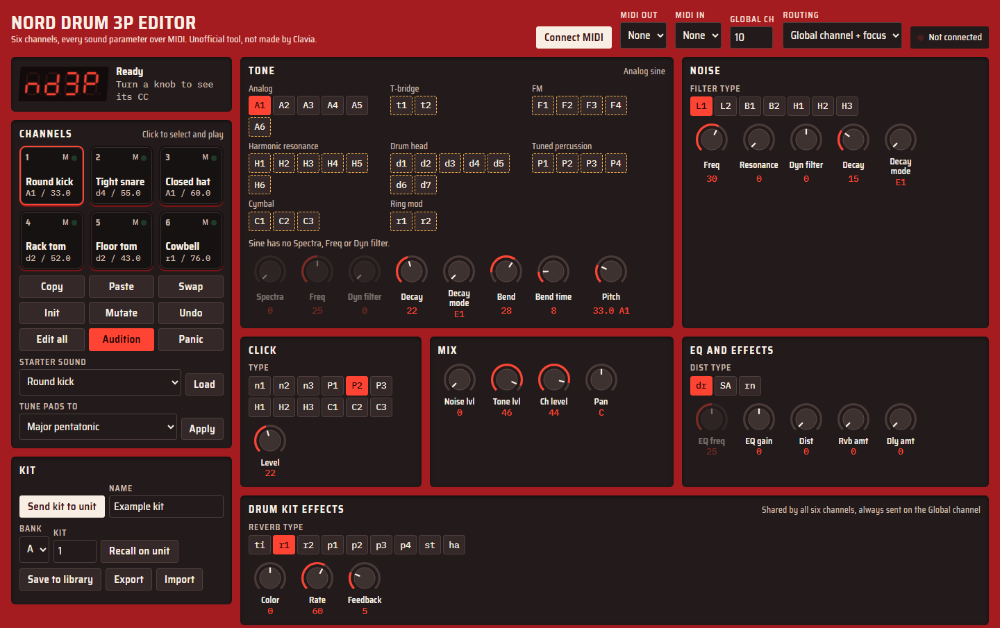
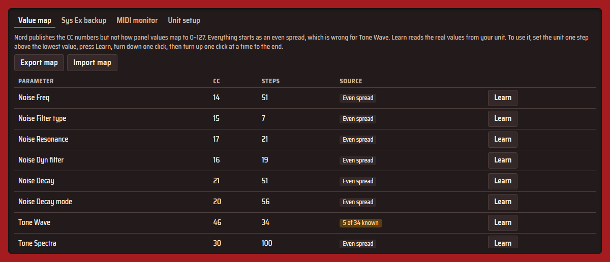
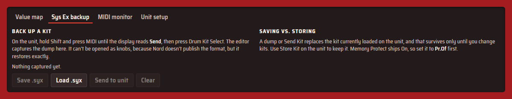
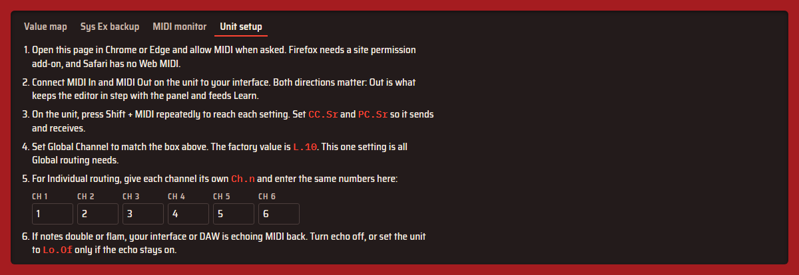

# Nord Drum 3P Editor

A free editor for the Nord Drum 3P, in your browser, as a standalone app, or as a VST3 plugin for Windows and Mac. Shape all six channels from your computer with knobs and buttons, and the screen follows the unit as you turn its dial.

**[Open the editor](https://virtualcrimez.github.io/nord-drum-3p-editor/)** · **[Download for Windows](https://github.com/virtualcrimez/nord-drum-3p-editor/releases/latest/download/Nord-Drum-3P-Editor-1.0.0-win.exe)** · **[Download for Mac](https://github.com/virtualcrimez/nord-drum-3p-editor/releases/latest/download/Nord-Drum-3P-Editor-1.0.0-mac.dmg)** · **[Get the VST3 plugin](#vst3-plugin)**



This is an unofficial tool. It isn't made by or affiliated with Clavia or Nord.

> [!WARNING]
> **Written with AI.** This editor's code was written largely by an AI coding assistant (Claude). It has been tested, but it hasn't had a full human code review, so expect bugs. Use it at your own risk, and keep exports and Sys Ex backups of any kits you care about.

## What it is

The Nord Drum 3P is edited through a small display and a single dial, one parameter at a time. This editor puts every sound parameter on one screen and talks to the unit over MIDI. The web page needs no install, and your kits stay in your own browser. The standalone app has the same editor, works offline, and remembers your session.

## What you need

- A Nord Drum 3P
- A MIDI interface connected to both MIDI In and MIDI Out on the unit
- For the web page: Chrome or Edge (Safari has no Web MIDI, and Firefox needs a site permission add-on)
- For the standalone app: Windows or a Mac (Intel or Apple Silicon)
- For the plugin: a DAW that loads VST3 on Windows or a Mac (Intel or Apple Silicon)

## Standalone app

The standalone app picks up where you left off. When you reopen it, it restores:

- Your current kit, selected channel, bank and kit number, and open tab
- Edit all, Audition, starter sound and pad tuning scale
- Any captured Sys Ex dump
- Your kit library and value map
- MIDI ports, channels and routing
- The window's size and position

It reconnects to MIDI by itself, and opening it never sends anything to the unit. The unit keeps its current sound until you edit something or press **Send kit to unit**. Undo history isn't kept between launches.

| System | Download |
| --- | --- |
| Windows | [Nord-Drum-3P-Editor-1.0.0-win.exe](https://github.com/virtualcrimez/nord-drum-3p-editor/releases/latest/download/Nord-Drum-3P-Editor-1.0.0-win.exe) |
| Mac (Intel and Apple Silicon) | [Nord-Drum-3P-Editor-1.0.0-mac.dmg](https://github.com/virtualcrimez/nord-drum-3p-editor/releases/latest/download/Nord-Drum-3P-Editor-1.0.0-mac.dmg) |

The apps aren't signed, so your computer warns you the first time:

- **Windows:** on the SmartScreen warning, click **More info**, then **Run anyway**.
- **Mac:** after the first blocked attempt, go to **System Settings > Privacy & Security** and click **Open Anyway**.

The app doesn't share storage with the web page. To bring across your value map, use **Export map** on the web page and **Import map** in the app. Export and import any kits you want to keep the same way.

## VST3 plugin

The plugin puts the same editor inside your DAW. It loads as an instrument and makes no sound of its own. Your kit saves with the project, while the value map, kit library and MIDI setup are shared by every project. Opening a project never sends anything to the unit, so press **Send kit to unit** when you want its sound back.

| System | Download |
| --- | --- |
| Windows | [Nord-Drum-3P-Editor-VST3-1.0.0-win.zip](https://github.com/virtualcrimez/nord-drum-3p-editor/releases/download/plugin-1.0.0/Nord-Drum-3P-Editor-VST3-1.0.0-win.zip) |
| Mac (Intel and Apple Silicon) | [Nord-Drum-3P-Editor-VST3-1.0.0-mac.zip](https://github.com/virtualcrimez/nord-drum-3p-editor/releases/download/plugin-1.0.0/Nord-Drum-3P-Editor-VST3-1.0.0-mac.zip) |

To install it:

- **Windows:** copy `Nord Drum 3P Editor.vst3` to `C:\Program Files\Common Files\VST3`.
- **Mac:** copy `Nord Drum 3P Editor.vst3` to `/Library/Audio/Plug-Ins/VST3`. The plugin isn't signed, so then run this in Terminal:

  ```
  xattr -cr "/Library/Audio/Plug-Ins/VST3/Nord Drum 3P Editor.vst3"
  ```

Then rescan plugins in your DAW.

For the fastest response, pick your MIDI port in the plugin, and set the plugin's Global channel to match the unit. Pads, knobs and the track's MIDI then go straight to the unit, even with the plugin window closed, and you don't need a second track for MIDI. On Windows the DAW must not be using that port, so in Ableton Live turn off Track and Remote for it under **Link, Tempo & MIDI**. **Through DAW** also works, but it waits for your DAW's audio buffer and often can't carry Sys Ex.

The plugin uses JUCE and is licensed under the GNU AGPL v3, separately from the rest of this project. See [plugin/LICENSE](plugin/LICENSE).

## Getting started

1. Connect the unit's MIDI In and MIDI Out to your interface.
2. On the unit, press **Shift + MIDI** repeatedly to reach each setting. Set `CC.Sr` and `PC.Sr` so it sends and receives.
3. Check the unit's Global Channel. The factory value is `L.10`, which matches the editor's default.
4. [Open the editor](https://virtualcrimez.github.io/nord-drum-3p-editor/), click **Connect MIDI**, and allow MIDI access when the browser asks. The standalone app connects by itself.
5. Turn a parameter on the unit and check that the editor follows it.

## What's on the page

| Section | What it does |
| --- | --- |
| **Channels** | Select and play the six channels. Copy, paste, swap, reset, undo, randomly nudge a sound with Mutate, or use Edit all to change all six at once. |
| **Starter sounds** | Load a simple kick, snare, hat, tom or other starting point. These are recipes for this editor, not factory patches. |
| **Tune pads** | Spread the six pitches across a scale, such as major pentatonic, blues or octaves. |
| **Tone** | Choose from 34 waves across the analog, T-bridge, FM, harmonic, drum head, tuned percussion, cymbal and ring mod families, then shape them with Spectra, Freq, Decay, Bend and Pitch. |
| **Noise** | Choose a filter type and set frequency, resonance, dynamic filter and decay. |
| **Click** | Choose a click type and level. |
| **Mix** | Set noise level, tone level, channel level and pan. |
| **EQ and effects** | Set EQ, distortion, and reverb and delay amounts for each channel. |
| **Drum kit effects** | Set the reverb and delay shared by all six channels. |
| **Kit** | Send a kit to the unit, recall a bank and kit on it, save kits to a library, or export and import them as files. |

## Value map

Nord publishes the MIDI CC numbers, but not how panel values map to 0–127. The editor starts with an even spread for most parameters, which is wrong for Tone Wave.



Only 5 of the 34 Tone Wave values are built in. There are two ways to teach the rest:

- **One at a time:** when the unit lands on an unknown wave, the Tone section asks you to click the matching button. Nothing is sent to the unit.
- **All at once:** press **Learn** next to Tone Wave and step through the waves on the unit.

The map is saved in your browser, or in the standalone app. Use **Export map** to keep a copy.

## Sys Ex backup

Capture a kit dump from the unit, save it as a `.syx` file, and send it back later.



Dumps restore exactly, but they can't be opened as knobs because Nord doesn't publish the format.

Sending a kit or dump only replaces the kit currently loaded on the unit. To keep it, use Store Kit on the unit. Memory Protect ships on, so set it to `Pr.Of` first.

## Unit setup

The Unit setup tab covers the settings the unit needs, including individual MIDI channels and what to do if notes double or flam.



The MIDI monitor tab shows the messages going in and out, which helps when something isn't responding.

## Limits

- **Reading kits:** the unit has no dump request, and the dump format is undocumented. The editor can recall a kit, but it can't read that kit's settings back. It only picks up changes as the unit sends them.
- **Pad Thres and Pad Sens:** the manual lists no MIDI control for these, so set them on the unit.
- **Browser storage:** on the web page, your kits and value map are stored per browser. Clearing site data removes them, so export anything you want to keep.

## Credits

CC numbers come from the Nord Drum 3P User Manual, Edition C. Bank Select, Tone Pitch steps, Channel Select ranges and the first five wave values come from owner reports.
